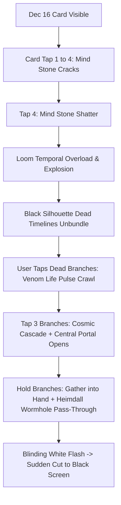

# ⏳ Avengers Doomsday (December 16: Loki Multiverse Event)

> **Document Purpose**: Complete tracking log for the Dec 16 Multiverse / Loki Yggdrasil Timeline card. Every task, performance audit, animation pass, bug fix, and design milestone is version-controlled and tracked here with its corresponding Git commit ID.

---

## 📋 Architecture & Sequence Overview

---

## 📜 Version History & Commit Changelog

| Milestone Name | Description | Commit ID | Status |
| :--- | :--- | :--- | :--- |
| **Project Genesis** | Initial Dec 16 Mind stone crack stages & Multiverse portal baseline | Prior | Done |
| **Diwali Signoff** | Diwali card complete & deployed; initiating Avengers Doomsday Dec 16 overhaul | `d14eed6` | Current Live |
| **Portal Restore & Baseline** | Fully restored original portal design and all 27 cosmic filaments untouched | `15e48ab` | Active Baseline |

---
*Created on: 2026-11-07 by Antigravity Agent*
